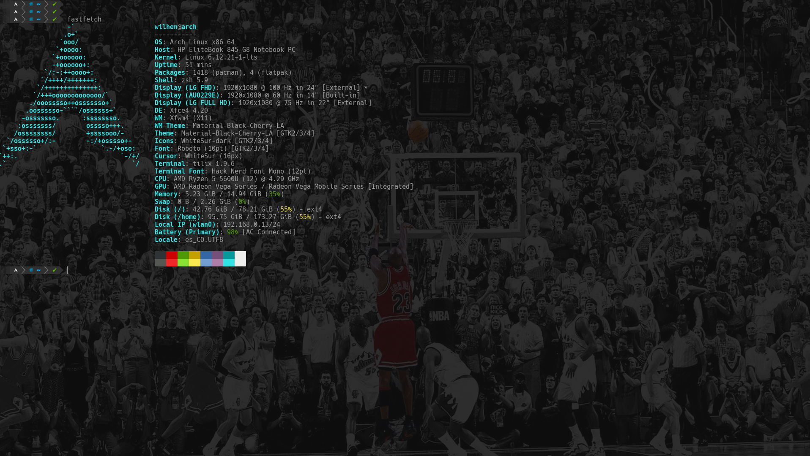
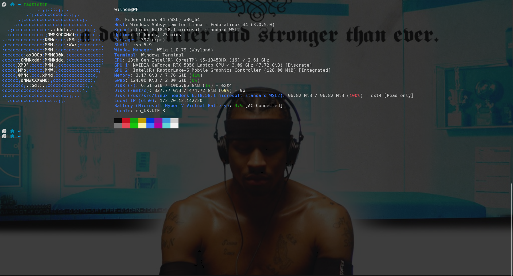

# 🐧 Linux dotfiles - Restore and configuration

Restore a Zsh setup with **Powerlevel10k**, a set of useful aliases, and fzf, replicating the configuration of this repository in minutes.

---

## 📑 Index

- [📌 Prerequisites](#pre-req)
- [📑 What kind of installation do you want?](#what-installation)
  - [📂 Manual](#manual)
  - [📂 Automated](#auto)
- [🖼️ Screenshots](#screenshots)
- [📢 Notes](#-notes)

---

## 📌 Prerequisites <a id="pre-req"></a>

Before restoring the dotfiles, make sure you have the following:

1. **A supported distribution**: Arch Linux, Fedora, Debian, or Ubuntu. Also tested on WSL Debian.
2. **Git** and **curl**, to clone the repository and download Oh My Zsh.
3. **sudo access** for your user, to install packages.

Install Git and curl if they are missing:

```sh
# Arch Linux
sudo pacman -S git curl

# Debian / Ubuntu
sudo apt install git curl

# Fedora
sudo dnf install git curl
```

> 💡 **Tip:** Run the installation as your normal user, not as root. The script asks for `sudo` when it needs it.

[⬆️ Back to index](#-index)

---

## 📑 What kind of installation do you want? <a id="what-installation"></a>

- 🖐️ [Manual](#manual): total control, step by step.
- ⚡ [Automated](#auto): a script that installs the dependencies and the configuration in one go.

[⬆️ Back to index](#-index)

---

### 📂 Manual Installation <a id="manual"></a>

1️⃣ **Clone the repository** into your home directory:

```sh
git clone -b linux https://github.com/wilhen199/dotfiles.git ~/dotfiles
```

2️⃣ **Install the packages** for your distribution:

```sh
# Arch Linux
sudo pacman -S --needed zsh zsh-syntax-highlighting zsh-autosuggestions bat lsd fzf xclip unzip fontconfig

# Debian / Ubuntu
sudo apt install zsh zsh-syntax-highlighting zsh-autosuggestions bat lsd fzf xclip unzip fontconfig

# Fedora
sudo dnf install zsh zsh-syntax-highlighting zsh-autosuggestions bat lsd fzf xclip unzip fontconfig
```

3️⃣ **Install Oh My Zsh and Powerlevel10k** without changing your `.zshrc` or default shell:

```sh
RUNZSH=no CHSH=no KEEP_ZSHRC=yes sh -c "$(curl -fsSL https://raw.githubusercontent.com/ohmyzsh/ohmyzsh/master/tools/install.sh)"
git clone --depth=1 https://github.com/romkatv/powerlevel10k.git ~/powerlevel10k
```

4️⃣ **Install the Hack Nerd Font** from the `fonts` folder of the repository:

```sh
mkdir -p ~/.local/share/fonts/HackNerdFont
unzip -o ~/dotfiles/fonts/Hack.zip -d ~/.local/share/fonts/HackNerdFont
fc-cache -f ~/.local/share/fonts
```

5️⃣ **Create the symbolic links** (existing files are moved to `.bak` first):

```sh
mv ~/.zshrc ~/.zshrc.bak 2>/dev/null
mv ~/.p10k.zsh ~/.p10k.zsh.bak 2>/dev/null

ln -sfn ~/dotfiles/files/.zshrc ~/.zshrc
ln -sfn ~/dotfiles/files/.p10k.zsh ~/.p10k.zsh
```

6️⃣ **Restore the Tilix configuration** (optional, only if you use Tilix):

```sh
dconf load /com/gexperts/Tilix/ < ~/dotfiles/tilix/tilix_backup.conf
```

7️⃣ **Make Zsh your default shell** and apply the changes:

```sh
chsh -s "$(which zsh)"
source ~/.zshrc
```

> 💡 **Tip:** The `.zshrc` loads the plugins from `/usr/share/zsh-plugins/`. The automated installation creates those paths for you. The `sudo`, `copydir`, and `copyfile` plugins are not packaged, so the script downloads them from Oh My Zsh. If you install manually, see step 4 of `install.sh` for the exact paths.

[⬆️ Back to index](#-index)

---

### 📂 Automated installation <a id="auto"></a>

**1️⃣ Clone the repository** (skip this step if you already have `~/dotfiles`):

```sh
git clone -b linux https://github.com/wilhen199/dotfiles.git ~/dotfiles
```

**2️⃣ Enter the `dotfiles` folder and run `install.sh` as your normal user**

```sh
cd ~/dotfiles
bash install.sh
```

Script will install:

- Zsh, with Oh My Zsh and the plugins `sudo`, `copydir`, and `copyfile`
- [Powerlevel10k](https://github.com/romkatv/powerlevel10k)
- `zsh-syntax-highlighting` and `zsh-autosuggestions`
- Font Hack Nerd Font
- `bat`, `lsd`, and `fzf` (with its key bindings and completion)
- `xclip`, `unzip`, and `fontconfig`
- Links for `.zshrc` and `.p10k.zsh`, backing up any existing files
- Zsh as the default shell for your user and for root, with the same configuration

When it finishes, open a new terminal. The first time, Powerlevel10k asks you to configure the prompt.

[⬆️ Back to index](#-index)

---

## 🖼️ Screenshots <a id="screenshots"></a>

Here is a preview of how the configuration should look after the restoration:




---

## 📢 Notes

- **Terminal font:** select **Hack Nerd Font** in your terminal emulator (for example, Tilix). Otherwise the prompt icons will not display.
- **WSL:** fonts installed inside WSL distribution are not visible to Windows Terminal. To use the font there, extract `Hack.zip` on Windows, install the `.ttf` files for all users, and select the font in the Windows Terminal settings.
- **Debian / Ubuntu:** `bat` is installed as `batcat`. The script creates a `bat` command in `/usr/local/bin`. Some older releases do not include `lsd` in their repositories. If that happens, install it from the [lsd releases page](https://github.com/lsd-rs/lsd/releases).
- **Root:** the root configuration links point to your home directory. If you change your username or home path, update those links.
- **Root cache files:** because root uses your Oh My Zsh folder, some cache files may end up owned by root. If you see permission errors, run `sudo chown -R $USER:$USER ~/.oh-my-zsh/cache`.
- **fzf:** its installer runs with `--all`, which can append lines to `.zshrc`. Since that file is linked to the repository, check the changes with `git -C ~/dotfiles diff` and commit them if they are useful.
- **Running it again:** `install.sh` is safe to run multiple times. Steps that are already done are skipped or updated.
- **Updating the dotfiles later:**

  ```sh
  cd ~/dotfiles
  git pull origin linux
  ```

[⬆️ Back to index](#-index)

---

✍️ **Wilhen**

<p align="left">
  <a href="https://linkedin.com/in/wilhen-figueredo" target="_blank" rel="noopener">
    
  </a>
  <a href="mailto:wilhen199@gmail.com">
    
  </a>
  <a href="https://wilhenfigueredo.dev" target="_blank" rel="noopener">
    
  </a>
</p>

---