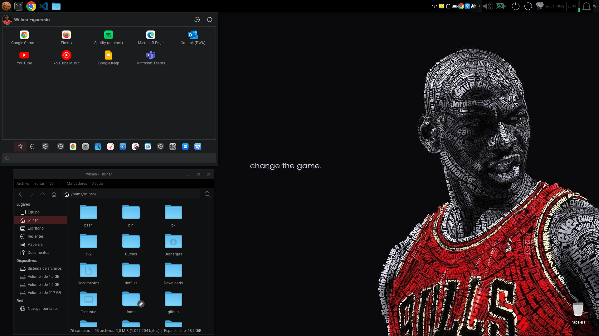
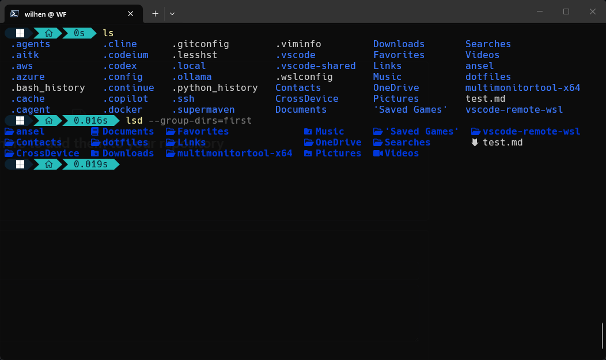
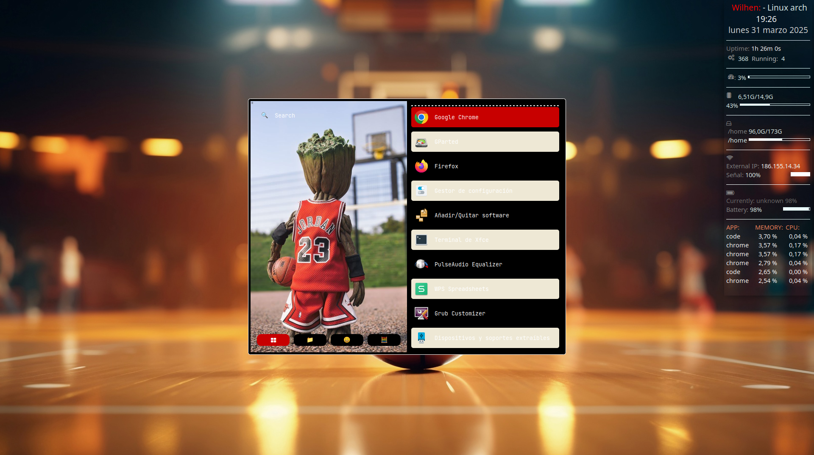

# 🛠️ Dotfiles

Personal configuration files for **Linux** and **Windows**, organized in separate branches for each platform.

🖥️ **Available brances:**
- 🐧 **[Linux](https://github.com/wilhen199/dotfiles/tree/linux)** → Zsh with Powerlevel10k, aliases, and desktop configuration (XFCE, Tilix, Conky, Rofi). Supports Arch Linux, Fedora, Debian, and Ubuntu.
- 🪟 **[Windows](https://github.com/wilhen199/dotfiles/tree/windows)** → Windows Terminal and PowerShell configuration with Oh My Posh.

---

## 📸 Screenshots

| Linux | Windows / WSL |
|-------|---------|
|  |  |
|  |  |
|   |  |


---

## 🖥️ Getting Started

Each platform has its own branch with its own installation guide. Clone only the branch you need.

### 🐧 Linux

```sh
git clone -b linux https://github.com/wilhen199/dotfiles.git
```

See the [Linux branch README](https://github.com/wilhen199/dotfiles/tree/linux) for the automated installer and manual steps.

### 🪟 Windows (PowerShell)

```powershell
git clone -b windows https://github.com/wilhen199/dotfiles.git
```

See the [Windows branch README](https://github.com/wilhen199/dotfiles/tree/windows) for setup instructions.

---

✍️ **Wilhen**

<p align="left">
  <a href="https://linkedin.com/in/wilhen-figueredo" target="_blank" rel="noopener">
    
  </a>
  <a href="mailto:wilhen199@gmail.com">
    
  </a>
  <a href="https://wilhenfigueredo.dev" target="_blank" rel="noopener">
    
  </a>
</p>
